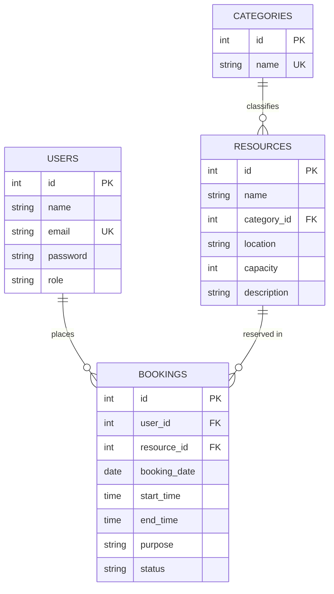

# CampusNest — Database Schema Documentation

## 1. Overview
This document defines the relational database schema for **CampusNest** using **PostgreSQL**.

A relational database organizes data into structured tables linked together through **relationships**. This ensures that every booking is tied to a valid user and a valid resource, preventing orphaned records, invalid bookings, and data corruption.

---

## 2. Entity Relationship Diagram (ERD)



---

## 3. Table Definitions & Explanations

### Table 1: `users`
Stores account and authentication credentials for all individuals accessing the platform.

| Column | Data Type | Constraints | Description |
|---|---|---|---|
| `id` | `SERIAL` (or `INTEGER`) | `PRIMARY KEY` | Unique identifier for each user. |
| `name` | `VARCHAR(100)` | `NOT NULL` | Full name of the student or administrator. |
| `email` | `VARCHAR(255)` | `NOT NULL, UNIQUE` | Institutional email address used for login and notifications. |
| `password` | `VARCHAR(255)` | `NOT NULL` | Securely hashed password (never stored in plain text). |
| `role` | `VARCHAR(20)` | `NOT NULL, CHECK (role IN ('student', 'admin'))` | Access level: controls whether the user sees student or admin features. |

**Why this table matters:**
It separates identities and permissions. A single role column allows our backend (FastAPI) to guard admin endpoints (like approving requests) from regular students.

---

### Table 2: `categories`
Groups campus facilities into logical sections (e.g., Hostel Rooms, Computer Labs, Seminar Halls, Sports Courts).

| Column | Data Type | Constraints | Description |
|---|---|---|---|
| `id` | `SERIAL` | `PRIMARY KEY` | Unique identifier for the category. |
| `name` | `VARCHAR(50)` | `NOT NULL, UNIQUE` | Name of the facility type (e.g., `Hostel`, `Lab`, `Seminar Hall`, `Sports`). |

**Why this table matters:**
Rather than typing categories as raw text in the `resources` table (which causes typos like `"lab"`, `"Lab"`, `"laboratory"`), a dedicated category table standardizes resource classification and enables clean filtering in the UI.

---

### Table 3: `resources`
Stores each bookable venue, facility, or room on campus.

| Column | Data Type | Constraints | Description |
|---|---|---|---|
| `id` | `SERIAL` | `PRIMARY KEY` | Unique identifier for the resource. |
| `name` | `VARCHAR(120)` | `NOT NULL` | Resource name (e.g., "Auditorium A", "Physics Lab 102"). |
| `category_id` | `INTEGER` | `NOT NULL, FOREIGN KEY REFERENCES categories(id)` | Identifies which category this resource belongs to. |
| `location` | `VARCHAR(150)` | `NOT NULL` | Physical location (e.g., "Block C, 2nd Floor"). |
| `capacity` | `INTEGER` | `NOT NULL, CHECK (capacity > 0)` | Maximum number of people the facility accommodates. |
| `description` | `TEXT` | `NULLABLE` | Helpful details (projectors available, AC, specialized equipment). |

**Why this table matters:**
This represents the inventory students browse and search. It links directly to `categories` via `category_id`.

---

### Table 4: `bookings`
Captures every reservation request submitted by a student.

| Column | Data Type | Constraints | Description |
|---|---|---|---|
| `id` | `SERIAL` | `PRIMARY KEY` | Unique identifier for the booking request. |
| `user_id` | `INTEGER` | `NOT NULL, FOREIGN KEY REFERENCES users(id)` | The student who requested this booking. |
| `resource_id` | `INTEGER` | `NOT NULL, FOREIGN KEY REFERENCES resources(id)` | The specific resource being requested. |
| `booking_date` | `DATE` | `NOT NULL` | The date of the reservation. |
| `start_time` | `TIME` | `NOT NULL` | Scheduled start time. |
| `end_time` | `TIME` | `NOT NULL, CHECK (end_time > start_time)` | Scheduled end time (must be after start time). |
| `purpose` | `TEXT` | `NOT NULL` | Student explanation for the reservation request. |
| `status` | `VARCHAR(20)` | `NOT NULL, DEFAULT 'pending', CHECK (status IN ('pending', 'approved', 'rejected', 'cancelled'))` | Current lifecycle status of the booking. |

**Why this table matters:**
`bookings` is the core transaction table of CampusNest. It ties a student (`user_id`) to a facility (`resource_id`) over a specific date and time interval.

---

## 4. Table Relationships

1. **`categories` to `resources` (One-to-Many / 1:N)**
   - One category can have multiple resources (e.g., "Sports" has Badminton Court 1, Tennis Court, and Football Field).
   - Each resource belongs to exactly one category via `resources.category_id`.

2. **`users` to `bookings` (One-to-Many / 1:N)**
   - One user can submit multiple booking requests over time.
   - Each booking is linked to exactly one user who created it via `bookings.user_id`.

3. **`resources` to `bookings` (One-to-Many / 1:N)**
   - One resource can be booked many times across different dates and time slots.
   - Each booking record is tied to exactly one resource via `bookings.resource_id`.

---

## 5. How This Schema Prevents Unrelated and Invalid Records

In database design, maintaining accuracy is called **Referential Integrity**. PostgreSQL enforces this using constraints:

1. **Foreign Key Constraints (Preventing Ghost Records):**
   - A student cannot submit a booking with a non-existent `resource_id` or `user_id`. If user `99` does not exist in `users`, PostgreSQL rejects the insert immediately.
   - A resource cannot reference a non-existent `category_id`.

2. **Deletion Protection (`ON DELETE RESTRICT` / `CASCADE`):**
   - If an admin attempts to delete a category that still contains resources, PostgreSQL blocks the action (`RESTRICT`), preventing orphaned resources without a category.

3. **Domain Constraints (`CHECK` constraints):**
   - **Role restriction:** `role` can only be `'student'` or `'admin'`, preventing invalid user states.
   - **Status restriction:** `status` can only be `'pending'`, `'approved'`, `'rejected'`, or `'cancelled'`.
   - **Time logic:** `end_time > start_time` ensures no booking can end before it begins or have zero duration.
   - **Capacity sanity:** `capacity > 0` ensures rooms cannot have invalid or negative capacities.

4. **Uniqueness (`UNIQUE` constraints):**
   - Every user must register with a unique email address, preventing duplicate student accounts.
   - Category names are unique to avoid duplicate categories like having two "Hostel" entries.

---

## 6. PostgreSQL Reference DDL (SQL Script)

```sql
-- 1. Create categories table
CREATE TABLE categories (
    id SERIAL PRIMARY KEY,
    name VARCHAR(50) NOT NULL UNIQUE
);

-- 2. Create users table
CREATE TABLE users (
    id SERIAL PRIMARY KEY,
    name VARCHAR(100) NOT NULL,
    email VARCHAR(255) NOT NULL UNIQUE,
    password VARCHAR(255) NOT NULL,
    role VARCHAR(20) NOT NULL CHECK (role IN ('student', 'admin'))
);

-- 3. Create resources table
CREATE TABLE resources (
    id SERIAL PRIMARY KEY,
    name VARCHAR(120) NOT NULL,
    category_id INTEGER NOT NULL REFERENCES categories(id) ON DELETE RESTRICT,
    location VARCHAR(150) NOT NULL,
    capacity INTEGER NOT NULL CHECK (capacity > 0),
    description TEXT
);

-- 4. Create bookings table
CREATE TABLE bookings (
    id SERIAL PRIMARY KEY,
    user_id INTEGER NOT NULL REFERENCES users(id) ON DELETE CASCADE,
    resource_id INTEGER NOT NULL REFERENCES resources(id) ON DELETE RESTRICT,
    booking_date DATE NOT NULL,
    start_time TIME NOT NULL,
    end_time TIME NOT NULL,
    purpose TEXT NOT NULL,
    status VARCHAR(20) NOT NULL DEFAULT 'pending' CHECK (status IN ('pending', 'approved', 'rejected', 'cancelled')),
    CONSTRAINT chk_booking_time CHECK (end_time > start_time)
);
```
